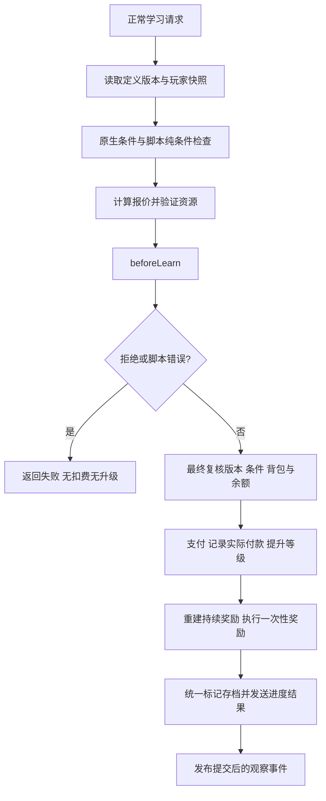

# Skill Atlas × KubeJS 兼容接口设计建议

日期：2026-10-15。设计基线：Skill Atlas `2612neoforge` 分支，提交 `9f9ca01`。

**这是一份待实现的设计文档。下文的 `SkillAtlasEvents`、`SkillAtlas`、构建器、事件字段和脚本示例都是建议契约，当前发布的 Skill Atlas 1.0.0 尚不提供这些接口。** 已确认的现状与建议实现分开说明；示例不能直接复制到当前发布版使用。

## 1. 建议先做什么

最值得做的是让整合包作者能够：

1. 用脚本增加、修改和删除技能、分类、点数池。
2. 查询玩家技能等级、余额、学习条件与下一等级费用。
3. 在学习前增加限制，在学习成功后联动任务、阶段、称号等系统。
4. 根据自己的玩法发放点数，或调整原有计点行为。
5. 安全调用学习、重置、发点、扣点，无须拼接命令。
6. 在第二阶段加入自定义条件、自定义奖励和费用调整。

推荐对外只设两个主要入口：

| 入口 | 用途 |
| --- | --- |
| `SkillAtlasEvents` | 监听图谱定义、学习、重置、点数和计点事件 |
| `SkillAtlas` | 提供查询、玩家操作、定义快照和诊断方法 |

首版不必同时增加 `player.skills`、`player.skillAtlas`、十几个全局对象等别名。先把一个稳定入口做好，后续再考虑便利写法。

## 2. 已核对的现有能力

以下是现有源码事实，不是新增接口承诺。

| 范围 | 当前行为 | 对兼容设计的影响 |
| --- | --- | --- |
| 学习 | 校验后扣实际经验、交付物品和池点数，记录付款，提升等级，刷新奖励，发送结果 | 脚本应接入同一学习服务，不能另写一套扣费逻辑 |
| 管理操作 | 已有发点、设置点数、授予等级、重置和重载命令 | 可以抽出公共服务，避免让脚本执行命令字符串 |
| 费用 | 正常学习记录每级实际付款，免费授予使用空付款占位；经验按实际经验值处理 | 折扣必须记录实付；退款不能套用重载后的新价格 |
| 奖励 | 属性、效果、免疫可重建；命令奖励属于一次性执行 | 必须区分持续奖励与一次性奖励，不能在每次刷新时发物品 |
| 计点 | 有击杀、挖掘、制作、钓鱼、成就、游戏时间、移动、收获与熔炼入口 | 新事件应针对 Skill Atlas 的计点，不重复包装全部原版事件 |
| 定义变更 | 编辑和重载后会校验、更新版本、同步，并按需要处理玩家进度 | 脚本变更也必须走该提交过程 |
| KubeJS | 当前没有 KubeJS 依赖或脚本桥接 | 需要新增适配层；不是把现有 Java 方法简单改个名字即可 |

核心源码依据：[学习与管理入口](https://github.com/hp3081925122/Skill-Atlas/blob/9f9ca01/src/main/java/com/hp/skillatlas/server/AtlasServer.java#L514)、[付款与进度](https://github.com/hp3081925122/Skill-Atlas/blob/9f9ca01/src/main/java/com/hp/skillatlas/data/PlayerProgress.java#L92)、[奖励刷新与命令](https://github.com/hp3081925122/Skill-Atlas/blob/9f9ca01/src/main/java/com/hp/skillatlas/server/RewardManager.java#L46)、[点数累计](https://github.com/hp3081925122/Skill-Atlas/blob/9f9ca01/src/main/java/com/hp/skillatlas/server/PointTracker.java#L185)。

### 2.1 ID 和数值约束

- 技能、分类、点数池 ID 使用 `[a-z0-9_.\-]{1,64}`，不接受 `namespace:path`。例如 `haste`、`farming`、`pack_artisan`。
- 物品、属性、效果等注册表 ID 才使用 `minecraft:diamond` 这种形式。
- 默认池 ID 为 `combat`、`mining`、`farming`、`fishing`、`running`、`smelting`。附魔分类直接消耗经验，不应凭空假定存在 `enchanting` 点数池。
- 现有定义上限是 64 个点数池、64 个分类、10000 个技能；单个技能最多 100 级。
- 池余额为 Java `long`，上限为 `1000000000000`，可以用 JavaScript 安全整数精确表示；进度累计器等 `long` 字段不保证始终处于 JavaScript 安全整数范围。
- 移动的内部累计单位是厘米，而配置的移动目标会由格数乘以 100。不能把“增加 100 进度”默认为增加 100 格。

依据：[ID 规则](https://github.com/hp3081925122/Skill-Atlas/blob/9f9ca01/src/main/java/com/hp/skillatlas/data/Json.java#L17)、[定义限额](https://github.com/hp3081925122/Skill-Atlas/blob/9f9ca01/src/main/java/com/hp/skillatlas/data/AtlasDefinition.java#L18)、[池与移动单位](https://github.com/hp3081925122/Skill-Atlas/blob/9f9ca01/src/main/java/com/hp/skillatlas/data/PointPool.java#L15)、[余额限制](https://github.com/hp3081925122/Skill-Atlas/blob/9f9ca01/src/main/java/com/hp/skillatlas/data/PlayerProgress.java#L16)。脚本构建器沿用这些约束，不另外放宽。

## 3. 版本和接入方式

建议先落地当前的 26.1.2 NeoForge，再为其他版本提供独立适配器，尽量保持脚本层名称和语义一致。

| Minecraft / 加载器 | 已核对的 KubeJS 材料 | 结论 |
| --- | --- | --- |
| 26.1.2 NeoForge | 本地 `26.1.2-8.0.4` 源码；官方 `v26.1.2-neoforge-8.0.6` 发布与关键源码 | 可以开始实现；最终仍需使用选定版本的实际组合测试 |
| 1.21.1 NeoForge | 本地 `2101.7.2-build.277` 源码和 JAR | 可以做同语义适配，不能假定 Java 签名与 26.1.2 相同 |
| 1.20.1 Forge | 本地 `2001.6.5-build.26` JAR，关键签名经 `javap` 核对 | 需要旧版独立适配，不能直接复制新版插件和事件类 |

26.1.2 的插件通过 JAR 根目录的 `kubejs.plugins.txt` 发现，插件接口提供事件组、绑定和类型转换注册点。新版使用 `KubeEvent`；需要取消能力的事件必须注册结果支持，并由发布端消费取消结果。事件处理同步跟随调用线程，不能把调用脚本等同于异步执行。[官方插件源码](https://github.com/kube-mods/kubejs/blob/v26.1.2-neoforge-8.0.6/src/main/java/dev/latvian/mods/kubejs/plugin/KubeJSPlugin.java)、[事件发布源码](https://github.com/kube-mods/kubejs/blob/v26.1.2-neoforge-8.0.6/src/main/java/dev/latvian/mods/kubejs/event/EventHandler.java)、[取消语义](https://github.com/kube-mods/kubejs/blob/v26.1.2-neoforge-8.0.6/src/main/java/dev/latvian/mods/kubejs/event/KubeEvent.java)。

脚本按用途放入 `server_scripts`、`startup_scripts` 或 `client_scripts`；这些是不同脚本生命周期，不能混用。[官方事件与脚本类型说明](https://kubejs.com/wiki/events)。26.1.2 的正式版本存在性见[官方发布列表](https://github.com/kube-mods/kubejs/releases)。

集成建议放进 Skill Atlas 自身的隔离兼容包：开发依赖使用 `compileOnly`，测试时再加入运行依赖；不安装 KubeJS 时核心类不得引用其类型。按项目规则，不把可选依赖写进 `mods.toml` 或 `neoforge.mods.toml`，也不把 KubeJS/Rhino 打包进本模组。

本地 API 证据保存在 `D:/AI临时文件/skill-atlas-kubejs-audit`。这些证据用于设计，不代表三个版本均已实现或测试兼容。

## 4. 所有接口共用的规则

### 4.1 服务端是数据权威

- 学习、发点、扣点、重置和定义提交只在服务端主线程执行。
- `server_scripts` 中提供完整操作 API；客户端只读接口另设 `SkillAtlasClient`，不向客户端暴露写入方法。
- 同步助手自动更新存档标记、属性、效果和客户端。脚本通常不应再调用 `save()`、`refresh()`、`sync()`。
- 离线玩家写入暂不作为首版能力。以实际 `ServerPlayer` 调用，避免靠名字寻找玩家或悄悄加载离线档案。
- 异步回调必须先调度回服务端线程；错误线程调用返回 `wrong_thread`，不自动异步执行一个无法立即返回结果的操作。

### 4.2 参数、返回值和只读视图

- 技能和池 ID 接收字符串；玩家接收 KubeJS 可识别的服务端玩家包装对象或原始服务端玩家。
- 整数输入先检查有限、非负、无小数和范围，再转换 Java 数值；拒绝 `NaN`、无穷大以及溢出值。
- 普通余额和费用可返回 JavaScript 数字；可能越过安全整数范围的累计值始终提供十进制字符串，如 `unitsText`，不要静默丢精度。
- `getNode()`、`getPool()`、`getProgress()` 等返回快照，不暴露可直接修改的内部 Map、付款列表或定义对象。
- `getNode('unknown')` 返回 `null`；`getLevel('unknown')` 等玩家操作返回明确错误，不能把拼错 ID 当作一个未学习技能继续执行。
- 所有写入方法返回统一结果，不只返回模糊的 `true/false`。

建议结果结构：

```js
// 建议返回结构，不是当前版本已有对象。
const suggestedResult = {
  ok: true,
  code: 'ok',
  message: Text.of('操作成功'),
  transactionId: '由服务端生成的唯一事务标识',
  actualDelta: 2,
  oldLevel: 0,
  newLevel: 1,
  revision: 12
}
```

字段按操作提供；失败时 `ok=false` 并给出稳定 `code` 与本地化消息。建议错误码至少包含 `unknown_node`、`unknown_pool`、`invalid_argument`、`max_level`、`prerequisite`、`condition_failed`、`insufficient_points`、`insufficient_experience`、`insufficient_items`、`script_denied`、`script_error`、`stale_definition`、`reentrant_operation`、`wrong_thread`、`integration_unavailable`。不要让脚本解析中文提示判断失败原因。

### 4.3 事件字段和来源

建议运行时事件按适用情况提供：`player`、`server`、`atlas`、`revision`、`source`、`reason`、`transactionId`、`parentTransactionId`。

- `source` 是桥接层生成的来源枚举，如 `learn`、`acquire`、`script`、`command`、`reset`、`definition_change`。
- `reason` 是更具体的用途标识，如 `pack_boss_reward`；不能靠传入 reason 伪造系统退款或绕过检查。
- `nodeId`、`categoryId`、`poolId` 按事件提供；整棵树重置等操作可能没有单一 nodeId。
- 节点和池快照只读；事件只开放表格明确标记的可变字段。
- 同一次变更中的子步骤共享事务关系。学习扣点、重置退款不能被再次当作独立的自然发点来处理。

## 5. 建议事件清单

P0 表示首版优先；P1 表示核心流程稳定后增加；P2 表示有明确使用场景再做。优先级不意味着当前已经存在。

| 事件 | 级别 / 脚本 | 触发点 | 可取消 / 可修改 | 典型用途 |
| --- | --- | --- | --- | --- |
| `definitions` | P0 / server | 从基础配置构建脚本生效图谱时 | 修改暂存构建器；不直接改线上定义 | 添加分类、点数池、技能，调整现有节点 |
| `beforeLearn` | P0 / server | 学习验证完成、最终复核和扣费之前 | 可以拒绝；不直接修改付款和等级 | 阶段、世界、职业、任务限制 |
| `learned` | P0 / server | 一次学习已经提交、原生奖励处理完成后 | 不可取消，只读 | 任务联动、广播、成就、一次性额外反馈 |
| `beforeReset` | P0 / server | 玩家或脚本请求重置、计算好变更范围之后 | 可以拒绝；重载强制修正不走此可取消入口 | 限制洗点场景、确认任务条件 |
| `reset` | P0 / server | 等级、退款、奖励刷新完成之后 | 不可取消，只读 | 清理职业缓存、更新任务进度 |
| `pointsChanging` | P0 / server | 独立发点、独立扣点或设置余额提交前 | 可以拒绝；按操作限制调整目标数额 | 双倍活动、特定来源禁发点 |
| `pointsChanged` | P0 / server | 任一实际余额变化提交后 | 不可取消，只读 | 显示通知、记账、任务统计 |
| `progressing` | P0 / server | 原有行为匹配到池、尚未累计行为进度时 | 可拒绝该池计点，可调整正向进度 | 指定区域不计点、职业行为加成 |
| `reloaded` | P0 / server | 新的有效定义已提交、进度处理及同步完成后 | 不可取消，只读 | 重建依赖图谱的脚本缓存 |
| `conditionTypes` | P1 / server | 构建本代脚本条件类型注册表时 | 注册暂存条件类型 | 任务、声望、职业等自定义前置 |
| `rewardTypes` | P1 / server | 构建本代脚本奖励类型注册表时 | 注册暂存奖励类型 | 第三方能力与一次性奖励 |
| `acquisitionTypes` | P2 / server | 构建本代脚本计点类型注册表时 | 注册暂存来源类型 | 需要独立阈值与上限的外部行为 |
| `levelChanged` | P1 / server | 学习、授予、重置或定义修正导致等级变化后 | 不可取消，只读 | 希望覆盖所有变更来源的任务或称号系统 |
| `learningCost` | P1 / server | 计算下一等级的服务端报价时 | 改报价副本，不改玩家状态 | 折扣、免费活动、按等级变更交付物 |
| `learnFailed` | P1 / server | 一个实际学习请求失败后 | 不可取消 | 调试、受控提示和审计；不是每帧预览事件 |
| `reloadFailed` | P1 / server | 定义或脚本集成重建失败后 | 不可取消 | 管理员诊断；脚本本身不可用时还须写日志 |
| `tooltip` | P2 / client | 生成或失效刷新一个技能说明缓存时 | 可追加展示行 | 显示其他模组的阶段、职业信息 |
| `screenOpened` | P2 / client | 图谱界面成功打开后 | 不可取消 | 教程提示、记录用户选中分类 |

没有建议为每个属性计算、每帧绘制、每个移动厘米都发布一个通用脚本事件。原版和 KubeJS 已有的破坏、击杀、钓鱼事件继续使用原接口；Skill Atlas 新增的事件专门负责自己的业务决策。

### 5.1 `beforeLearn` / `learned`

建议字段：`nodeId`、`categoryId`、`oldLevel`、`newLevel`、`cost`、`source`、`transactionId`。

- `beforeLearn` 通过 `event.deny(message)` 拒绝并设置玩家可见原因；也支持标准 `event.cancel()`。
- 两种拒绝都必须由 Java 发布端真正阻止后续扣费。只注册事件而不消费返回结果，没有意义。
- 拒绝后不扣点、不扣经验、不交物品、不升等级、不执行奖励命令。
- 不能通过这个事件跳过原有前置、强行把目标等级改成 30，或直接修改 `cost`。
- 首版额外条件只作用于实际点击；若要在按钮状态和详情中提前展示，使用第 8 节的自定义条件接口。
- 同一事务最终提交前重新检查余额、物品、条件和定义版本。监听器期间背包或状态可能被其他处理器修改，不能信任最早一次检查。
- `learned` 每次成功提升一级触发一次；授予、重登、重生、属性刷新不触发它。
- `learned` 看到的是已提交状态。监听器报错不能撤销学习，也不能让客户端收到“学习失败”后再次付款。
- 不把任意脚本副作用视为可回滚事务；外部模组调用、执行命令和发消息无法统一撤销。

### 5.2 `beforeReset` / `reset`

建议字段：`scope`、`requestedIds`、`affectedNodes`、`refundPreview` 或最终 `refund`、`source`。

- 支持整树、分类或指定节点的设计，但首版至少先把现有重置语义包装正确。
- 当前重置只处理显式传入的节点，不自动撤销后继技能。首版助手默认沿用此语义，前置主要作为学习条件，不悄悄改成持续装备条件。
- 若以后提供可选的 `dependencyPolicy:'cascade'`，则先按实际 all/any 和等级门槛计算失去条件的后继，将完整范围一次交给事件；不能只看直接箭头。该模式属于额外功能，不是当前 reset 已有能力。
- 退款依据每一级的实际付款账本。免单、折扣、管理员免费授予，不能退回配置标价。
- 现有账本记录点数和经验；不承诺返还交付物或撤销已经执行的一次性命令。
- 删除定义或缩小最高等级产生的强制修正不能被 `beforeReset` 取消，否则玩家会残留无法存在的等级。此类变化由 `levelChanged`、`pointsChanged` 和 `reloaded` 观察。
- 费用中含第三方脚本资产时，退款能力必须由该资产适配单独声明；不要默认为所有外部资产都能退。

### 5.3 `pointsChanging` / `pointsChanged`

建议字段：`poolId`、`oldPoints`、`requestedDelta`、可变 `delta`、最终 `actualDelta`、`newPoints`、`source`、`reason`。

**`pointsChanging` 只拦截独立余额操作。学习扣费、账本退款等事务内部变化不再次进入可取消发点流程。** 所有已提交的实际变化都可产生 `pointsChanged`，并标明来源。

- 自然获得和脚本奖励允许把正向增量调整为更小、更多或零；最终仍受余额边界与获取规则限制。
- 独立扣点不允许被随意改成发点；调整必须保持操作方向，并重新验证余额。
- `setPoints` 的 proposed delta 由当前余额计算，成功结果报告实际变化；相同余额无变化就不发 `pointsChanged`。
- 自然计点达到发放上限后，不应因脚本加倍突破上限。按“匹配行为 → progressing → 累计阈值 → proposed 发点 → pointsChanging → 上限约束 → 提交”的顺序结算。
- 自然发点被拒绝或改成零时，不消耗已累计的整轮进度，不增加已发放总量；要避免反复尝试，应该在 `progressing` 处屏蔽对应行为。这要求重构现有先写余数的结算顺序，不能在当前 `PointTracker.progress` 返回后才补一个取消事件。
- 学习扣费与重置退款不用活动倍率，避免双倍退款或扣费被取消后仍学会技能。
- `pointsChanged` 监听器内不能立即再次修改同一玩家同一池，防止“加点事件再加点”的递归。确有后续工作时，显式安排到下一 tick，并按来源过滤。

### 5.4 `progressing`

建议字段：`poolId`、`acquisitionType`、`units`、`unit`、`detail`、`player`。

- 本事件取消的是 Skill Atlas 对该池的行为累计，不能撤销已经发生的挖矿、收获、击杀或钓鱼。
- 先通过原有匹配与排除条件，再进入事件。不能用这个事件让创造模式或 FakePlayer 自动突破默认排除。
- `unit` 明确为 `count`、`seconds` 或 `centimeters`；移动单位不能含糊。
- `detail` 只提供当前来源适用的只读信息，例如方块 ID、实体 ID、物品 ID、维度和坐标；事件字段不适用时为 `null`，不要构造假的完整上下文。
- 一次动作可命中多个池，每池分别结算。取消一个池不能误伤其他池。
- 移动应先按玩家累计，建议每 20 tick 统一发一次计点事件，保留不足阈值的余量。不能每更新一厘米都进入 Rhino。

### 5.5 `learningCost`

建议在核心版本稳定后做，重点不是一个简单的“改数字”回调。

- 同一个纯报价过程服务于 `checkLearn()`、技能详情和真实学习。
- 可修改报价副本中的点数、实际经验值和交付物，使用明确方法如 `setAmount()`、`setItems()`；不允许直接写付款账本。
- 此事件是可重复查询，禁止发点、扣物品、执行奖励命令或调用其他写入助手。
- 客户端仅显示服务端返回的报价，不自己跑一遍服务端条件。
- 报价需要定义 revision、玩家状态版本和有效期。真正学习时重新报价并校验；不要持有一个旧报价直接扣费。
- 任意随机折扣若每次报价都重抽，会导致显示和扣费不一致。首版建议禁止随机报价，确需随机时再设计稳定报价 token。
- 最终记录实际支付，重置按此退款。`0` 可以表示免费；负数、无穷大和不合法组件必须拒绝。

## 6. 建议提供的辅助方法

以下签名仍是设计建议。`p` 表示 `SkillAtlas.player(event.player)` 返回的服务端玩家助手，助手只在当前服务端上下文中使用，不长期跨重载缓存。

### 6.1 图谱查询

| 方法 | 返回 | 说明 |
| --- | --- | --- |
| `SkillAtlas.getRevision()` | 整数 | 当前生效定义版本 |
| `SkillAtlas.hasNode(id)` | 布尔 | ID 是否存在 |
| `SkillAtlas.getNode(id)` | 节点快照 / null | 名称、分类、最高等级、前置、每级费用和奖励描述 |
| `SkillAtlas.getCategory(id)` | 分类快照 / null | 绑定池、背景及节点关系 |
| `SkillAtlas.getPool(id)` | 点数池快照 / null | 初始值、获取类型、阈值和上限 |
| `SkillAtlas.getNodeIds(categoryId)` | 字符串数组 | 查询指定分类内的技能；省略参数时列全部 |
| `SkillAtlas.getCategoryIds()` | 字符串数组 | 列分类 |
| `SkillAtlas.getPoolIds()` | 字符串数组 | 列点数池 |
| `SkillAtlas.exportDefinition()` | JSON 快照 | 导出当前生效图谱，纯数据，不含回调和玩家进度 |
| `SkillAtlas.validateDefinition(json)` | 校验结果 | 检查引用、前置环、等级、组件、尺寸和限额；不提交 |

`getNode()` 同时提供 ID 与可翻译文本信息，脚本按 ID 判断；名称相同不代表同一个技能。导出的纯 JSON 若引用自定义条件或奖励类型，导入环境仍必须安装对应脚本注册，不能宣称 JSON 自带这些函数。

### 6.2 玩家查询

| 方法 | 返回 | 说明 |
| --- | --- | --- |
| `p.getLevel(nodeId)` | 整数 | 当前等级 |
| `p.hasSkill(nodeId, minLevel)` | 布尔 | 至少达到指定等级；minLevel 默认 1 |
| `p.isMaxed(nodeId)` | 布尔 | 是否已达该节点上限 |
| `p.getLearnedSkills()` | 只读 ID → 等级快照 | 适合任务判断，不直接返回内部存储 Map |
| `p.getPoints(poolId)` | 数字 | 当前可用池点数 |
| `p.getProgress(poolId)` | 进度快照 | 累计单位、下一阈值、已发放数、上限；大整数用文本字段 |
| `p.checkLearn(nodeId)` | 检查结果 | 下一等级、原生阻碍、脚本条件、费用、缺少物品、revision |
| `p.canLearn(nodeId)` | 布尔 | `checkLearn().ok` 的便利形式；不触发 beforeLearn 和 learned |
| `p.getRawExperience()` | 数字 | 实际经验总量；明确区别于经验等级 |

`checkLearn()` 应返回全部可用于说明的阻碍，而非只返回第一句报错。例如 `missingItems`、`requiredLevels`、`conditionMessages`。动态条件需要走只读自定义条件，不能拿可能发消息、发物品的 `beforeLearn` 监听器当成预览检查。

### 6.3 玩家写入

| 方法 | 建议级别 | 必须满足的语义 |
| --- | --- | --- |
| `p.learn(nodeId)` | P0 | 正常学习一级，完整检查、扣费、付款账本、奖励和事件 |
| `p.addPoints(poolId, amount, reason)` | P0 | 显式增加余额；经过 pointsChanging；不伪装成原生行为累计 |
| `p.spendPoints(poolId, amount, reason)` | P0 | 独立扣点；不足时整体失败，不先扣到零；不进入技能退款账本 |
| `p.setPoints(poolId, value, reason)` | P0 | 明确设置余额；不清空获取进度或已发放统计 |
| `p.reset(options)` | P0 | 复用账本退款和奖励清理；按 scope 明确范围 |
| `p.addProgress(poolId, amount, reason)` | P1 | 显式注入行为进度，使用该池声明的单位和上限，经过 progressing |
| `p.grant(nodeId, targetLevel, options)` | P1 | 明确的管理授予；不收费用、不伪造付款；默认沿用现有 grant 的新增等级命令奖励语义 |
| `p.resetAcquisition(poolId)` | P1 | 单独清理计点余量/获取上限统计，不与技能洗点混为一谈 |
| `p.sendProgress()` | P1 / 运维 | 仅重发快照，不改存档或重复奖励；普通脚本无需调用 |

补充约束：

- `addPoints` 是整合包作者显式发余额，不消耗原生池的行为发放上限。希望遵循原生获取节奏和上限时，使用 `addProgress`。两者要在名称、说明和测试中区分。
- `spendPoints` 适合脚本商店等用途；它的支出不能在重置技能时退回。
- `learn` 不接收 `ignorePrerequisites=true`、`free=true` 之类的便利后门。免费授予走明确的管理操作。
- `reset({scope:'all'})`、`reset({scope:'category', id:'mining'})`、`reset({scope:'node', id:'haste'})` 是建议参数形式；重置默认按原付款退款，不额外退交付物。
- 管理操作、普通学习和重载修正要在 `levelChanged.source` 中区分。免费授予不触发 `learned`，但现有 grant 会执行新增各等级的命令奖励；默认保持该行为，并可新增显式 `runCommands:false` 选项。不要把它描述成“免费授予绝不会发一次性奖励”。
- 不提供 `p.saveNBT()`、`p.setPaymentLedger()` 或直接写属性 Map 等方法。
- `addProgress` 初版只增加正向进度；不提供负数撤回行为，也不重放过去的任意事件。

### 6.4 客户端便利方法

P2 再考虑 `SkillAtlasClient.open(categoryId)`、`focus(nodeId)`、`getSelectedNodeId()`、`getLevel(nodeId)` 和只读 tooltip 扩展。

客户端读取的是最近一次同步快照，不代表可以据此批准学习。服务端若想让玩家打开图谱，需要独立设计受限的“打开图谱”通知；不能让客户端任意上报一个函数名叫服务端执行。

## 7. 脚本创建与修改图谱

建议统一使用 `SkillAtlasEvents.definitions`，在 `server_scripts` 注册监听器；回调执行于服务器图谱构建或重建时，不是脚本文件求值时立刻修改全局注册表。

建议构建器能力：

| 操作 | 建议方法 |
| --- | --- |
| 新建 | `createPool(id)`、`createCategory(id)`、`createNode(id)` |
| 修改 | `modifyPool(id, callback)`、`modifyCategory(id, callback)`、`modifyNode(id, callback)` |
| 删除 | `removePool(id)`、`removeCategory(id)`、`removeNode(id)` |
| 查询 | `hasNode(id)`、`getNodeIds(categoryId)` 等暂存快照方法 |

节点构建器应覆盖现有数据能力：分类、名称、图标、描述、坐标、形状、大小、隐藏、解锁条件、前置 all/any、前置等级门槛、是否画线、每级费用和奖励。分类构建器覆盖背景、平铺、图片；点数池构建器覆盖现有获取方式与参数。不能只开放最简单的“名称 + 属性”。

### 7.1 推荐采用基础配置加脚本覆盖

1. 读取基础 `config/skill_atlas/atlas.json` 为一个独立副本。
2. 对副本执行本次脚本定义回调；重复 ID、未知引用和脚本异常全部收集错误位置。
3. 完整校验后一次提交，更新 revision，处理玩家进度，统一同步。
4. 默认不把脚本覆盖结果写回基础 JSON。否则每次 `/reload` 都会在上次脚本结果上再追加一遍节点。
5. `/reload` 重建应从同一基础文件开始；重复执行两次，结果与一次相同。
6. 脚本控制的节点及字段在游戏编辑器中明确标注并锁定，或提供“基础图谱编辑模式”；不能允许玩家编辑后下次重载又悄悄丢失。
7. 当前有效图谱可以导出用于查看；导出不等于把所有脚本函数永久写进配置。

首版对脚本涉及的整个对象采用“脚本管理、编辑器只读”更容易解释。以后确实需要字段级混合编辑，再增加来源记录；不建议一开始就做复杂的双向合并。

### 7.2 等级和前置写法

- 保留当前模型：一个节点可以有多级，也可以把等级拆成多个单级节点。
- `requiresLevelGreaterThan('haste', 2)` 明确表示 `haste > 2`，即至少 3 级，避免方法叫“需要等级”却不知道是 `>` 还是 `>=`。
- `requires('haste')` 等价于现有默认大于 0 的门槛。
- `.level(n, callback)` 中 `n` 从 1 开始，必须连续，不能存在只有第 1 与第 3 级的定义。
- 点数费用与实际经验费用明确选择；经验等级不作为新的消费类型。
- 交付物支持普通物品、数量和目标版本的完整组件条件。1.20.1 与新版的数据表示需要版本适配，不能让新版组件示例看起来能原样用于旧 NBT。

## 8. 很有价值的扩展接口

### 8.1 自定义学习条件：P1，优先于大量细分事件

建议提供 `SkillAtlasEvents.conditionTypes`，定义纯检查回调以及玩家提示。

示例类型包括任务阶段、声望、队伍身份、某维度通关记录或其他模组职业。节点引用“类型 ID + 纯数据参数”，客户端同步可读提示和当前结果，服务端保存与执行回调。

每个类型至少包含：

| 部分 | 含义 |
| --- | --- |
| `validate(data)` | 重载时检查参数是否完整合法 |
| `test(ctx, data)` | 只读判断；在预览和实际学习复核时共用 |
| `describe(ctx, data)` | 返回需求说明和未满足提示 |

条件回调禁止扣钱、发物品或修改等级。用于测试的是状态，不是执行一次交易。条件注册建议放 `server_scripts` 的一代注册表中，支持热重载；没有必要为了声明回调强迫放到 `startup_scripts`。

仅作为一次额外门禁且不需要预览时，使用 `beforeLearn` 就足够；需要按钮和详情同步显示时再使用条件类型。

### 8.2 自定义奖励：P1，分成两种

**持续型奖励**：学习后持续生效，重置后应失效，例如第三方属性修饰、能力开关。建议注册 `apply`、`remove` 或一个可重复执行的 `reconcile` 接口。每份奖励有稳定 key，重登、重生或重载时重复刷新不得叠加。

**一次性奖励**：物品、货币、指令、任务推进，通常只在正常学习该等级时执行。建议明确为 `onLearn`，不会在重建持续状态时执行。

关键规则：

- 不要用同一个 `reward` 回调同时负责发物品和属性恢复。
- 事件触发一次不等于物品跨崩溃严格只发一次。没有接收方的幂等事务支持，就不能保证任意外部奖励的“恰好一次”。
- 对可靠的跨模组发奖，允许传递稳定的奖励标识，由接收方去重；不能只把一个临时 UUID 存在当前函数里。
- 一次性奖励默认每次付费重新学习都可以再次触发；若需求是“每个存档仅第一次学到给一次”，必须增加明确的玩家领取标记策略。
- 重置不能自动收回已经花掉的货币、使用过的物品或命令副作用；需要可撤销奖励时必须单独提供撤销契约。
- 自定义一次性奖励失败时报告具体失败，不自动退款后重试整笔学习，防止部分外部奖励已到账又再次发放。

### 8.3 自定义计点来源：P1/P2

首版可以让脚本通过原有 KubeJS 事件直接调用 `addPoints`；这是覆盖任务、Boss、结构探索等需求的最短路径。

需要“每完成 N 次才给一点，并受总获取上限限制”时，再提供 `addProgress` 或脚本来源类型：

- 点数池声明脚本来源 ID、目标次数、每次给点数和总上限。
- 回调或既有 KubeJS 事件显式上报完成次数。
- 桥接层复用计数、余量、上限和保存，不让每个整合包自己写一次 persistentData 计数器。
- 不为脚本来源默认启动“每玩家每 tick 轮询一切”的机制。

外部来源 ID 可以设计成资源 ID，例如 `pack:boss_kill`；这是新增类型标识，不意味着现有节点和池 ID 也允许冒号。

## 9. 学习交易和事件顺序

建议最终流程如下。`learningCost` 未实现时，报价只读现有定义费用。



- before 类回调异常：整笔操作拒绝，返回 `script_error`，日志包含脚本位置、事件、技能与事务 ID。
- learned 等 after 类回调异常：保留已提交结果，记录错误；不重跑整笔学习。
- 经验支付仍尊重现有经验事件语义。经验事件取消或改变实际扣除金额时，应使费用支付失败，不继续扣其他资产。
- 外部奖励副作用不能统一回滚，因此“无扣费失败”保证覆盖提交前的验证与本模组可控支付；不能把提交后某个脚本发奖失败伪装成整个交易从未发生。
- 预览不发 beforeLearn、learned、pointsChanged 等写入事件。
- 同一玩家处于学习、重置或管理等级变更时，禁止从事件内部重入同类玩家事务，返回 `reentrant_operation`。观察回调确有后续操作时下一 tick 再做。
- `learned` 监听器里重复给相同属性不是推荐用法。持续属性应定义成节点奖励，由统一刷新机制维护。

## 10. 重载、编辑和旧数据边界

### 10.1 本次只设计新集成，不增加旧存档兼容

不做旧版数据格式兼容。以下处理是同一版本运行期间脚本和图谱变化的必要一致性要求，不是导入旧版本存档。

当前源码已会在节点删除或等级上限缩小时按实际付款截断并退款；只改费用而不降低等级，不重新计算过去的付款。新脚本定义应保留这个原则。[当前截断与账本行为](https://github.com/hp3081925122/Skill-Atlas/blob/9f9ca01/src/main/java/com/hp/skillatlas/data/PlayerProgress.java#L92)。

额外需要明确：删除点数池目前不会自动清理所有玩家保存的同名余额、计数和发放统计。脚本层不能把“删除后重建同名池”宣传成天然干净；需要单独决定是否拒绝删除仍被使用的池，或提供管理员显式清理工具。

### 10.2 建议重载策略

- 服务端启动时，先确保 server_scripts 的相关监听器和类型注册可用，再构建有效图谱；具体生命周期挂钩要通过集成测试确定，不能假定 ServerStarted 就一定够晚。
- `/reload` 完成相关脚本重载后统一重建一次。`/skillatlas reload` 重读基础图谱并应用当前有效脚本代；不私自额外启动一遍完整 KubeJS 脚本重载。
- 条件、奖励、来源注册使用“一代暂存，成功后替换”的方式，避免回调重复追加和旧世界对象泄漏。
- 定义校验失败保留上次有效定义并报告错误。
- KubeJS 自己的事件监听器重载失败，不等于集成层能够恢复旧 Rhino 上下文。不能承诺靠保存旧 Java 对象就完整回滚旧脚本。
- 若定义依赖的自定义回调已不可用，相关学习交易返回 `integration_unavailable`，不给免费通过；管理员修复脚本后再重载。已有原生持续奖励不应因此被无故重复发放。
- 不把 JS 函数、Rhino 上下文、ServerPlayer 或世界对象写进 JSON、SavedData 或同步包。

## 11. 建议脚本示例

以下全部使用拟议 API，**尚未实现**。示例中的 `pack_` 技能和条件为整合包自定义示例，不是默认节点。

### 11.1 禁止在下界学习某技能

```js
// 放入 server_scripts；这里只阻止学习，不会卸下已经获得的能力。
SkillAtlasEvents.beforeLearn('pack_cold_training', event => {
  if (String(event.player.level.dimension) === 'minecraft:the_nether') {
    event.deny(Text.red('请离开下界后再学习此技能'))
  }
})
```

带技能 ID 的监听形式要求桥接层注册目标过滤支持；不是任意事件都天然接受第二种参数签名。`deny` 是本集成拟议便利方法，不是 KubeJS 所有事件的通用方法。

### 11.2 正常学习后发出提示

```js
// learned 只在正常学习成功后触发，重登和刷新属性不重复触发。
SkillAtlasEvents.learned('pack_artisan', event => {
  event.player.tell(Text.gold('工匠技能已提升至 ' + event.newLevel + ' 级'))
})
```

若要联动任务或阶段，在此调用目标模组已有的可靠接口；不要在兼容文档里虚构某个第三方模组的方法。

### 11.3 自然获得的挖掘点数翻倍

```js
// 只调整自然发点，学习扣点和退款不参与倍率。
SkillAtlasEvents.pointsChanging('mining', event => {
  if (event.source === 'acquire' && event.delta > 0) {
    event.delta = event.delta * 2
  }
})
```

桥接层在修改后验证整数与范围，并执行原生获取上限约束；结果事件给出最终实际增量。

### 11.4 指定维度不增加收获计点

```js
// progressing 拒绝的是这个池的累计，作物仍按原事件正常收获。
SkillAtlasEvents.progressing('farming', event => {
  if (String(event.player.level.dimension) === 'minecraft:the_end') {
    event.cancel()
  }
})
```

### 11.5 命令完成一次任务后给点数

```js
// 这里每执行一次自定义命令就奖励一次，不包含“任务只领取一次”的去重逻辑。
ServerEvents.basicCommand('atlas_bonus', event => {
  if (event.player == null) return
  const result = SkillAtlas.player(event.player).addPoints('combat', 2, 'pack_command_bonus')
  if (!result.ok) {
    event.player.tell(result.message)
  }
})
```

需要真正的一次性任务奖励时，由任务系统的领取状态或明确的持久标记去重；不能让这个示例看起来天然防止重复领取。

两个命令示例使用 26.1.2 的 `ServerEvents.basicCommand`，默认面向管理员或单机权限上下文，并检查控制台执行时可能为空的 player。旧文档中的 `customCommand` 不应原样照搬到此版本；确需所有玩家可用时才选 `basicPublicCommand`，发点命令不能默认公开。[目标版本命令事件源码](https://github.com/kube-mods/kubejs/blob/v26.1.2-neoforge-8.0.6/src/main/java/dev/latvian/mods/kubejs/plugin/builtin/event/ServerEvents.java)。

### 11.6 查询并正常学习

```js
// 写入方法仍会重新验证，查询通过不意味着随后一定有足够资源。
ServerEvents.basicCommand('atlas_learn_haste', event => {
  if (event.player == null) return
  const atlas = SkillAtlas.player(event.player)
  const check = atlas.checkLearn('haste')
  if (!check.ok) {
    event.player.tell(check.message)
    return
  }
  const result = atlas.learn('haste')
  event.player.tell(result.message)
})
```

### 11.7 添加一个两级技能

```js
// definitions 操作暂存图谱；提交由桥接层统一完成，不在脚本里调用 save 或 sync。
SkillAtlasEvents.definitions(event => {
  event.createNode('pack_artisan')
    .category('combat')
    .name('工匠入门')
    .icon('minecraft:anvil')
    .description('提高攻击伤害。')
    .position(0, 360)
    .level(1, rank => {
      rank.cost({ type: 'skill_points', amount: 1 })
      rank.attributeReward('minecraft:attack_damage', 1, 'add')
    })
    .level(2, rank => {
      rank.cost({ type: 'skill_points', amount: 2 })
      rank.attributeReward('minecraft:attack_damage', 2, 'add')
    })
})
```

每级奖励延续当前“只生效当前等级奖励”的模型：上例二级最终增加 2 点攻击伤害，不是 1+2=3。构建器必须在文档和编辑预览中强调这一点。`add` 是拟议脚本枚举，由版本适配器映射为对应 Java 运算类型。

### 11.8 实际经验费用与严格前置等级

```js
// 修改已有节点；经验 amount 指实际经验值，不是经验等级。
SkillAtlasEvents.definitions(event => {
  event.modifyNode('pack_artisan', node => {
    node.requiresLevelGreaterThan('haste', 2)
    node.level(1, rank => {
      rank.cost({ type: 'experience', amount: 100 })
    })
  })
})
```

前置 ID 必须存在，且严格门槛低于前置最高等级；如 `haste` 最高只有 2 级，则 `>2` 永远无法满足，应在提交时拒绝。若脚本拆成多文件，创建脚本必须排在修改脚本之前；更稳妥的是把相关定义放在同一个 definitions 回调内。

### 11.9 支持预览的自定义条件

```js
// 这是 P1 类型注册建议；条件读取状态但不扣费、不发奖。
SkillAtlasEvents.conditionTypes(event => {
  event.register('pack:player_flag', {
    validate: data => typeof data.flag === 'string' && data.flag.length > 0,
    test: (ctx, data) => !!ctx.player.persistentData[data.flag],
    describe: (ctx, data) => Text.of('需要完成：' + data.title)
  })
})

// 节点只存类型 ID 和参数，函数不写入图谱 JSON 或同步包。
SkillAtlasEvents.definitions(event => {
  event.modifyNode('pack_artisan', node => {
    node.condition('pack:player_flag', {
      flag: 'pack_first_trial_complete',
      title: '初次试炼'
    })
  })
})
```

此示例使用 KubeJS 对 persistentData 的属性解包，将布尔标记对应的 0/1 转为布尔值。不要改成直接判断原版 `CompoundTag.getBoolean(key)`：26.1.2 的这个 Java 方法返回 Optional，不能作为布尔真假使用。生产条件也应校验 title 类型，并使用语言键支持多语言。其他版本的数据访问仍需按其目标 API 核对。

## 12. 性能、异常和副作用

主要成本来自高频游戏行为进入 Rhino，以及大图谱重载时逐玩家刷新。建议实现时直接遵守：

1. 没有监听器时不构造事件、不复制大型快照；支持技能 ID、池 ID 过滤。
2. 移动和高频来源合并累计后再发布；点数到账通知按实际余额变更发送。
3. 默认不提供逐帧 JavaScript 绘制回调，也不让客户端 tooltip 每帧向服务端查条件。
4. 纯条件和报价可以缓存，但缓存键必须包含玩家状态与定义版本，不能让任务阶段变化后永久显示旧结果。
5. 不在每次小余额变化时完整重建所有属性；只有影响技能或定义的操作才进入相应刷新流程。
6. 定义变化统一批处理一次，不让每个 createNode 都同步全服；10000 节点或大量在线玩家需要实测重载成本。
7. 脚本异常日志包含事件、脚本位置、玩家 UUID、技能或池 ID、事务 ID；运行日志按项目要求使用英文，同类高频错误限流。
8. 深度和事务重入防护不能依赖“作者不会写递归”；after 事件也可能间接调用同一 API。
9. 主线程同步脚本会卡住服务器。不要在这些回调里请求 HTTP、读大文件、遍历所有区块或长时间等待。
10. 回调无法强行安全中断任意 Rhino 无限循环；性能保护主要依靠低频接口、限额、规范和可诊断的执行耗时。

## 13. 推荐实现顺序与验收

这是范围建议，不要求本次立刻实现所有内容。

| 阶段 | 建议交付 |
| --- | --- |
| 第一阶段 | 抽出统一玩家操作服务；只读查询；正常学习、余额操作和重置；P0 事件；不装 KubeJS 的隔离 |
| 第二阶段 | definitions 构建器、基础配置覆盖、脚本对象编辑锁定、重载和错误恢复 |
| 第三阶段 | 自定义条件、费用报价、自定义奖励、行为进度与 levelChanged |
| 第四阶段 | ProbeJS/类型提示、诊断导出、客户端便利接口和其他版本适配 |

首版可以先提供运行时事件与方法，再补定义构建器；不必为了“接口齐全”同时实现所有扩展。

### 必须验证的项目

- 不安装 KubeJS 时，专服与客户端都能正常启动，没有缺类错误。
- beforeLearn 拒绝、抛错、经验事件拒绝时，点数、经验、物品与等级保持一致。
- 正常学习、快捷学习、脚本学习复用同一逻辑；每次 learned 只触发一次。
- 查询和详情预览不发奖励、不扣费用、不触发提交后事件。
- 点数倍率不作用于学习扣费和退款；余额上限、自然获取上限与零增量通知正确。
- 改价后退款按实际付款；免费授予不会洗出原价点数；交付物不被无意复制。
- 默认重置保持显式范围，不偷偷撤销后继；如果实现可选级联模式，额外覆盖 all/any、严格等级门槛及跨分类依赖。
- 多个池命中、创造/旁观/FakePlayer 排除、移动厘米换算与聚合余量正确。
- 回调中重入被拒绝；after 事件报错不改变已提交结果。
- 连续两次 `/reload` 不重复节点、监听器、属性或一次性奖励。
- 无效定义不覆盖上次有效图谱；自定义回调不可用时不会绕过条件免费学习。
- 脚本管理节点在编辑器中有明确限制；手动基础编辑不会被悄悄写成脚本结果。
- 专服重启后付款账本、行为进度和奖励策略正确；客户端收到相同定义 revision。
- 实际双客户端验证学习、重置、图谱变更和脚本条件显示；模拟连接测试不能替代这个检查。
- 大量节点、在线玩家和移动行为下测主线程耗时；无监听器时不引入持续脚本开销。
- 在明确支持的每一个 KubeJS 版本分别运行；不能用 26.1.2 的编译成功证明 1.20.1 兼容。

## 14. 不建议首版开放的能力

- 任意读取、写入付款账本、SavedData、内部 Map 和同步 revision。
- 任意原始网络包、客户端请求执行脚本函数名、客户端写服务端数据。
- 每帧图谱渲染事件、每 tick 每玩家轮询所有技能。
- 把原生每一种游戏事件都再复制一个 SkillAtlasEvents 版本。
- 默认绕过前置或静默免费学习的通用方法。
- 自动退还任意外部脚本副作用、无接收方幂等支持的严格恰好一次发奖承诺。
- 靠调用 `/skillatlas ...` 命令实现全部脚本方法。
- 为兼容设计附带旧存档迁移或修改原有 ID 规则。

## 15. 源码接入位置建议

下列文件是现有逻辑位置；具体新类名在实施时再定，避免把本文的建议当作已有实现。

| 现有位置 | 推荐处理 |
| --- | --- |
| `AtlasServer.learn`、`grant`、`reset` | 抽出可返回结构化结果的玩家操作服务，包处理器、命令和脚本共用 |
| `PointTracker.progress` | 在匹配与原生排除之后、累计之前接 progressing；集中处理自然发点 |
| `PlayerProgress` | 保留账本与余额约束；统一操作服务负责发布事件，避免底层 setter 到处重入 |
| `RewardManager` | 明确持续刷新与一次性命令边界，再接自定义奖励类型 |
| `AtlasServer` 定义加载与 `definitionChanged` | 基础文件 + 脚本暂存 + 完整校验 + 一次提交 + 同步 |
| `EditOps` 和客户端编辑器 | 识别脚本管理对象，防止编辑与覆盖来源冲突 |
| 新增隔离兼容包与 `kubejs.plugins.txt` | 只在 KubeJS 可用时加载插件、事件包装、全局绑定和类型转换 |
| 现有网络协议 | 同步纯数据报价、条件结果与图谱，不同步 JS 回调；新增内容仍受字节与权限限制 |

建议把业务语义固定在 Skill Atlas 公共服务中，KubeJS 适配层只负责参数转换、事件投递和脚本生命周期。这样后续适配 1.21.1、1.20.1 或提供其他模组 API 时，不会出现三套付款和发奖逻辑。
